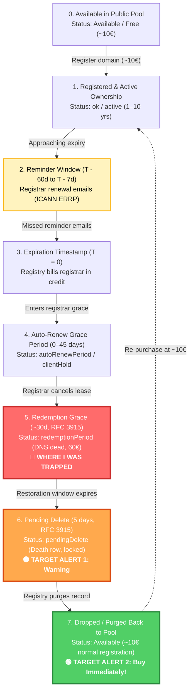

# Domain Renewal Alerter

<h4 align="center">Automated Domain Drop Alerter with GitHub Actions, RFC 3915, and Controlled AI</h4>
<h5 align="center"><a href="https://jamyvetter.net/posts/beating-icann-redemption-fees-domain-drop-alerter/">Read the Full Technical Article Here</a></h5>

<p align="center">
  <a href="https://github.com/jamyvetter/domain-renewal-alerter/issues">
    
  </a>
  <a href="https://github.com/jamyvetter/domain-renewal-alerter/actions/workflows/domain-monitor.yml">
    
  </a>
  <a href="https://jamyvetter.net/posts/beating-icann-redemption-fees-domain-drop-alerter/">
    
  </a>
</p>

<p align="center">
  <a href="#overview">Overview</a> •
  <a href="#features">Features</a> •
  <a href="#architecture">Architecture</a> •
  <a href="#quick-start">Quick Start</a> •
  <a href="#configuration">Configuration</a> •
  <a href="#-notes">Notes</a>
</p>

---

# Overview

**Domain Renewal Alerter** is a lightweight, zero-maintenance, automated pipeline running on **GitHub Actions**. It continuously inspects the WHOIS lifecycle status of an expiring or expired domain name to alert you the exact moment it drops back into the public pool.

This project was born out of a real-world scenario: an expired `.net` domain moved into the ICANN **Redemption Grace Period**, where the registrar demanded an exorbitant **50€ to 60€ restoration penalty** instead of the standard **~10€ registration fee**. Rather than paying the redemption ransom or manually refreshing WHOIS queries like a bot, this automated watcher monitors RFC 3915 lifecycle transitions and notifies you immediately on **Telegram**.

---

# Features

- **Automated Scheduling**: Scheduled twice daily via GitHub Actions `cron` (11:00 UTC and 13:00 UTC), strategically bracketing target domain registration/expiration hours.
- **Port 43 WHOIS Ingestion**: Queries authoritative TLD registry servers using `python-whois`.
- **Controlled LLM-as-a-Judge**: Leverages Google Gemini (`gemini-3.5-flash` via `google-genai`) to parse messy, multi-registrar WHOIS outputs into structured JSON.
- **Deterministic Alert Guards**: Hardened Python logic overrides LLM outputs to prevent false alarms, ensuring 🟢 alerts only fire when availability is strictly confirmed.
- **Push Alerts via Telegram**: Instant push notifications directly to your phone with prioritized emojis:
  - 🔴 **Daily Status**: Domain is still in `RedemptionPeriod` or active hold.
  - 🟠 **Imminent Drop**: Domain transitioned to `PendingDelete` (5-day final countdown).
  - 🟢 **Action Required**: Domain is released! Go register it immediately at regular cost.

---

# Architecture

```text
┌─────────────────────────┐
│  GitHub Actions (Cron)  │  (Scheduled 11:00 & 13:00 UTC)
└───────────┬─────────────┘
            │
            ▼
┌─────────────────────────┐
│   Port 43 WHOIS Query   │  (Raw unstandardized text dump)
└───────────┬─────────────┘
            │
            ▼
┌─────────────────────────┐
│   Gemini AI (Judge)     │  (Extracts status & drop estimates to JSON)
└───────────┬─────────────┘
            │
            ▼
┌─────────────────────────┐
│ Python Guard & Filter   │  (Strict deterministic keyword validation)
└───────────┬─────────────┘
            │
            ▼
┌─────────────────────────┐
│  Telegram Bot Webhook   │  (Instant mobile push notification)
└─────────────────────────┘
```

---

# Domain Lifecycle (RFC 3915)



```text
  [ 0. Available Pool ] ──(Buy at ~10€)──> [ 1. Active Ownership (ok) ]
                                                        │
                                                        ▼
                                           [ 2. Pre-Expiry Reminders (T-60d) ]
                                           (Missed emails in cluttered inbox!)
                                                        │
                                                        ▼
                                           [ 3. Expiration Timestamp (T=0) ]
                                                        │
                                                        ▼
                                           [ 4. Auto-Renew Grace (0–45d) ]
                                           (Standard ~10€ renewal still valid)
                                                        │ (Registrar cancels)
                                                        ▼
  🔴 WHERE I WAS TRAPPED (60€ Ransom)      [ 5. Redemption Grace (~30d) ]
                                           (DNS dead, heavy 50€–60€ penalty fee)
                                                        │
                                                        ▼
  🟠 TARGET ALERT 1 (Drop Imminent)        [ 6. Pending Delete (5 days) ]
                                           (Irreversible death row, no restoration)
                                                        │
                                                        ▼
  🟢 TARGET ALERT 2 (Buy Immediately!)     [ 7. Dropped / Available (~10€) ]
                                                        │
                                                        └──────(Re-purchase)──────┘
```

---

# Quick Start

### 1. Fork or Clone this Repository

```bash
git clone https://github.com/jamyvetter/domain-renewal-alerter.git
cd domain-renewal-alerter
```

### 2. Configure GitHub Secrets & Variables

In your GitHub repository, navigate to **Settings > Secrets and variables > Actions**:

#### Repository Secrets (Required):
- `GEMINI_API_KEY`: Your Google Gemini API Key (get one free at [Google AI Studio](https://aistudio.google.com/app/apikey)).
- `TELEGRAM_BOT_TOKEN`: The API token of your Telegram bot (created via [@BotFather](https://t.me/BotFather)).
- `TELEGRAM_CHAT_ID`: Your personal or group chat ID (obtained via [@userinfobot](https://t.me/userinfobot)).

> 💡 **Important Telegram Step**: Before running the alert, open your bot in Telegram and send it `/start`. Telegram bots are not permitted to message users without prior user interaction.

#### Repository Variables (Optional):
- `DOMAIN`: The domain name you want to track (e.g. `example.com`). Defaults to `jamyvetter.net` if omitted.

### 3. Run Manually or Wait for Cron

1. Go to the **Actions** tab in your GitHub repository.
   *(Note: If you forked this repository, click "I understand my workflows, go ahead and enable them" first).*
2. Select **Domain Renewal Monitor** in the left sidebar.
3. Click **Run workflow** to test execution immediately.

---

# Configuration

### Local Testing

To test the monitoring script on your local machine:

```bash
# 1. Create and activate a virtual environment
python3 -m venv .venv
source .venv/bin/activate

# 2. Install dependencies
pip install -r requirements.txt

# 3. Export environment variables
export GEMINI_API_KEY="your-gemini-api-key"
export TELEGRAM_BOT_TOKEN="your-telegram-bot-token"
export TELEGRAM_CHAT_ID="your-chat-id"
export DOMAIN="jamyvetter.net"

# 4. Execute the script
python monitor.py
```

---

# 📋 Notes

- **RFC 3915 Compliance**: Accurately tracks EPP status values including `redemptionPeriod`, `pendingDelete`, and `ok`.
- **Zero Running Costs**: Runs entirely within GitHub Actions free public runner tier and Google Gemini free/developer tier limits.
- **Safety First**: The pipeline does not execute automated purchases—it alerts human buyers immediately, avoiding unpredictable registrar billing APIs.
- **Controlled Surface Area**: By using Python for network and alerting while restricting LLM execution to semantic classification, the system avoids prompt injection and hallucination loops.

---

If you find this useful or have ideas for multi-domain support, feel free to open an issue or submit a pull request!
